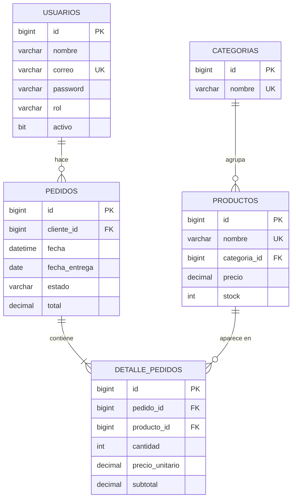

# 🥖 Sistema de atención en panadería — "El Buen Pan"

Proyecto del curso **Marcos de Desarrollo Web (UTP)**. Es una aplicación web hecha **solo con Spring Boot**: Spring Web MVC, Thymeleaf, Spring Data JPA (Hibernate), Bean Validation y Spring Security. Usa MySQL/MariaDB de **XAMPP** y Bootstrap en las vistas.

El cliente arma su pedido **mezclando varios tipos de pan**. El panadero lo prepara y el administrador gestiona todo el sistema.

---

## 1. Cómo levantar el proyecto

1. Abre **XAMPP** e inicia **MySQL** (puerto 3306). Para ver la base en phpMyAdmin inicia también **Apache** (phpMyAdmin es una página PHP que sirve Apache).
2. Abre en VS Code la carpeta `demo` (la que contiene el `pom.xml`).
3. Ejecuta `DemoApplication.java` con el botón **Run**, o en la terminal:
   ```
   .\mvnw.cmd spring-boot:run
   ```
4. Entra a **http://localhost:8084** (te lleva al login y, al ingresar, al menú de tu perfil).

Al arrancar, Spring Boot hace lo siguiente sin que tengas que tocar nada:

- crea la base de datos **`panaderia_db`** (parámetro `createDatabaseIfNotExist=true`);
- ejecuta el script **`schema.sql`**, que crea las **5 tablas** (`CREATE TABLE IF NOT EXISTS`);
- ejecuta el script **`data.sql`**, que carga usuarios, categorías y panes de ejemplo (`INSERT IGNORE`, no duplica).

Esto lo activa `spring.sql.init.mode=always`. Hibernate **no** crea tablas (`spring.jpa.hibernate.ddl-auto=none`): solo mapea las clases `@Entity` a las tablas que creó el script.

> `panaderia.sql` junta los dos scripts e incluye `CREATE DATABASE`, por si quieres crear todo a mano desde **phpMyAdmin → Importar**.

### Usuarios de prueba

| Perfil | Correo | Contraseña |
|---|---|---|
| Administrador | admin@panaderia.pe | admin123 |
| Panadero | panadero@panaderia.pe | panadero123 |
| Cliente | cliente@panaderia.pe | cliente123 |

Cualquier persona también puede crear su propia cuenta de **cliente** desde la opción "Crea tu cuenta" del login.

---

## 2. Estructura de carpetas

```
demo/
├── pom.xml                        → dependencias (starters de Spring Boot)
├── panaderia.sql                  → script completo para importar en phpMyAdmin (opcional)
└── src/main/
    ├── java/com/example/demo/
    │   ├── DemoApplication.java   → punto de arranque (@SpringBootApplication)
    │   ├── config/                → usuario en sesión para el menú
    │   ├── security/              → Spring Security: reglas de acceso, login y BCrypt
    │   ├── model/                 → entidades JPA (tablas) y enums
    │   ├── repository/            → acceso a datos (Spring Data JPA)
    │   ├── services/              → lógica de negocio (reglas, stock, estados)
    │   └── controller/            → controladores web (rutas y vistas)
    └── resources/
        ├── application.properties → puerto, conexión a MySQL, scripts SQL y JPA
        ├── schema.sql             → script que crea las tablas
        ├── data.sql               → script con los datos iniciales
        ├── static/css/            → estilos propios
        └── templates/             → vistas Thymeleaf (HTML)
            ├── fragments/         → menú, cabecera y alertas reutilizables
            ├── usuarios/  categorias/  productos/  pedidos/  tienda/
            └── login, registro, inicio, acceso-denegado, error
```

El proyecto sigue el patrón **MVC en capas**:

```
Navegador → Controller → Service → Repository → Base de datos
                ↓
           Vista Thymeleaf (HTML + Bootstrap)
```

- **Controller**: recibe la petición HTTP, valida el formulario y elige la vista.
- **Service**: contiene las reglas del negocio (por ejemplo, descontar el stock al pedir).
- **Repository**: consulta y guarda en la base de datos sin escribir SQL.
- **Model**: las clases que se convierten en tablas.

---

## 3. Base de datos (5 tablas)



| Tabla | Para qué sirve | Relación JPA |
|---|---|---|
| `usuarios` | Cuentas del sistema con su **rol** (ADMIN, PANADERO, CLIENTE) | — |
| `categorias` | Agrupa los panes (salados, dulces, integrales, especiales) | — |
| `productos` | Tipos de pan con precio y stock | `@ManyToOne` → categoría |
| `pedidos` | Cabecera del pedido: cliente, fechas, estado y total | `@ManyToOne` → usuario |
| `detalle_pedidos` | Cada pan de la **mezcla** con su cantidad y subtotal | `@ManyToOne` → pedido y producto |

**La "mezcla de panes"** se resuelve con la relación **pedido → detalle**: un pedido tiene varias líneas de detalle, una por cada tipo de pan elegido. Así se modela una relación muchos a muchos entre pedidos y productos.

---

## 4. Perfiles y qué puede hacer cada uno

| Función | Admin | Panadero | Cliente |
|---|:-:|:-:|:-:|
| Iniciar sesión y ver su menú | ✅ | ✅ | ✅ |
| Gestionar usuarios y asignar perfiles | ✅ | | |
| Gestionar categorías | ✅ | | |
| Gestionar panes (precio y stock) | ✅ | ✅ | |
| Ver todos los pedidos y cambiar su estado | ✅ | ✅ | |
| Crear un pedido mezclando panes | | | ✅ |
| Ver su historial y cancelar pedidos pendientes | | | ✅ |
| Registrarse desde el login | | | ✅ |

**Ciclo de vida de un pedido** (enum `EstadoPedido`):

```
PENDIENTE → EN PREPARACIÓN → LISTO → ENTREGADO
     └──────────┴──→ CANCELADO (se devuelve el stock)
```

---

## 5. Rutas principales

| Ruta | Acceso | Descripción |
|---|---|---|
| `/login`, `/registro` | Público | Inicio de sesión y registro de clientes |
| `/menu` | Autenticado | Menú principal según el perfil (a donde lleva el login) |
| `/admin/usuarios/**` | ADMIN | CRUD de usuarios |
| `/admin/categorias/**` | ADMIN | CRUD de categorías |
| `/productos/**` | ADMIN, PANADERO | CRUD de panes |
| `/pedidos/**` | ADMIN, PANADERO | Lista, detalle y cambio de estado |
| `/tienda/nuevo-pedido` | CLIENTE | Armar pedido mezclando panes |
| `/tienda/mis-pedidos/**` | CLIENTE | Historial, detalle y cancelación |

---

## 6. Conceptos aplicados (relación con el sílabo)

### Unidad 1 — Frameworks de front-end
- **Bootstrap 5** por CDN: navbar responsiva, grid de filas y columnas, tarjetas, tablas, badges, alertas y formularios.
- **JavaScript** en "Nuevo pedido": calcula en vivo el resumen y el total de la mezcla.
- CSS propio en `static/css/estilos.css`.

### Unidad 2 — Spring Boot, Spring Web y Thymeleaf
- `@SpringBootApplication`, **starters** del `pom.xml` y configuración en `application.properties`.
- **Inyección de dependencias por constructor**: Spring crea los objetos (beans) y los entrega a quien los necesita.
- `@Controller`, `@GetMapping`, `@PostMapping`, `@PathVariable`, `@RequestParam`, `@ModelAttribute`, `Model`.
- Patrón **PRG (Post/Redirect/Get)** con `RedirectAttributes` y mensajes *flash*, para que al recargar no se reenvíe el formulario.
- **Thymeleaf**: `th:each`, `th:if`, `th:text`, `th:field`, `th:errors`, `th:replace`, **fragmentos** reutilizables y utilidades `#numbers` y `#temporals`.

### Unidad 3 — Spring con bases de datos
- **ORM con Hibernate**: cada clase `@Entity` es una tabla y cada atributo es una columna.
- **JPA**: `@Id`, `@GeneratedValue`, `@Column`, `@Enumerated`, `@ManyToOne`, `@OneToMany(cascade, orphanRemoval)`.
- **Spring Data JPA**: interfaces que heredan de `JpaRepository`. Usan **consultas derivadas del nombre** (por ejemplo, `findByClienteCorreoOrderByIdDesc`) y `@EntityGraph` para traer el pedido con sus detalles en una sola consulta.
- **Spring Validator (Bean Validation)**: `@NotBlank`, `@Email`, `@Pattern`, `@DecimalMin`, `@Min`, `@Size`, junto con `@Valid` y `BindingResult`.
- **Restricciones en tablas**: claves foráneas, `UNIQUE` y `NOT NULL`.
- **Transacciones** con `@Transactional`: si falla una parte del pedido (por ejemplo, falta stock), no se guarda nada.
- CRUD completo de usuarios, categorías y productos.

### Unidad 4 — Spring Security
- **Autenticación** con formulario de login propio (`security/SeguridadConfig` → `formLogin`, que redirige a `/menu`).
- **Autorización por roles** con `hasRole` y `hasAnyRole` sobre las rutas.
- `UserDetailsService` propio (`security/UsuarioDetallesService`) que busca al usuario por su correo en la base de datos.
- **Contraseñas cifradas con BCrypt**: nunca se guardan en texto plano.
- **Protección CSRF**: Thymeleaf agrega el token automáticamente en los formularios `POST`.
- Cierre de sesión (`/logout` → `/login?logout`), página de acceso denegado y cuentas activas o inactivas.
- El menú cambia según el perfil gracias a `UsuarioActualAdvice` (`@ControllerAdvice`).

---

## 7. Reglas de negocio importantes

- Al crear un pedido **se descuenta el stock** de cada pan. Si no alcanza, se muestra cuánto queda y no se guarda nada.
- Al **cancelar** un pedido, el stock vuelve a sumarse.
- El cliente solo puede cancelar pedidos **pendientes**. El personal puede cancelar pedidos pendientes o en preparación.
- Un cliente **solo puede ver sus propios pedidos**.
- No se puede eliminar una categoría que tenga panes, ni un pan que ya esté en pedidos, ni un usuario con pedidos (se desactiva en su lugar).
- El administrador no puede quitarse su propio rol, cambiar su correo, desactivarse ni eliminarse.
